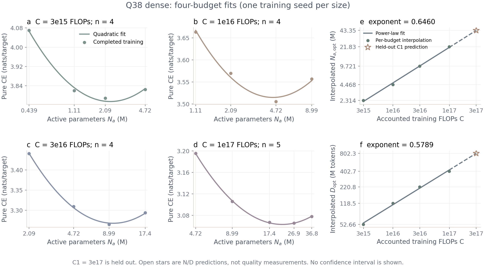

# Q38 dense

这是技术说明。四档 17 点与留出 C1（3e17 FLOPs 预算）均完成完整预算训练。外推 dense 的 EvalTime 降低 30.34%，累计 forward 计时缩短 5.573%，BPB 增加 0.03173；未达到 50 倍目标。

$N_a$ 是每 token 主预测路径激活参数量，排除全部 Embedding、输出头和训练专用 MTP；$T$ 为累计 forward 计时，不是程序墙钟时间。

| 模型 / 角色 | 隐藏宽度 / 层数 | $N_a$，M | BPB ↓ | 累计 forward 计时 $T$，秒 ↓ | EvalTime ↓ |
|---|---:|---:|---:|---:|---:|
| 26 号提交包 MoE / 基线 | 448 / 9 | 27.12 | 1.102 | 64.50 [64.44–68.23] | 19.80 [19.78–20.94] |
| 外推 dense / 当前 | 512 / 10 | 36.76 | 1.133 | 60.91 [59.65–62.08] | 13.79 [13.51–14.06] |

同一完整 A（`dolma3_mix_100M_a.jsonl`）、同一节点和实现，每个模型三次评测，表中为中位数 [最小值–最大值]；BPB 三次相同，不是三个训练种子。MoE/dense 的 EvalTime 中位数比为 1.436，累计 forward 计时中位数比为 1.059。两种配置的 $N_a$ 不同，归一化改善不能当作等幅的 $T$ 缩短；该结果不隔离 FFN 改动，也不是相同 BPB 下的加速。

## 结构与预算

固定形状的 C1–C4 dense 配置基于冻结 Q38 提交 [`6daa43d6`](https://github.com/yuzekai1234/qwen35-moe-sparse/commit/6daa43d6fdb5cb929036028fd7b03df488df1cc3)，只替换 MoE 前馈结构；每 token 激活参数近似不变，总参数减少。GDN、QSA、mHC、N-gram、层数、隐藏宽度及 MTP 保留，MTP 的前馈层同样替换。四档拟合后外推的 C1 则另选层数和隐藏宽度，不是固定形状的 FFN 单因素对照。

原 C1 的 FFN 为 64 个路由专家、每 token 选择 5 个，另有一个共享专家；单专家与共享专家中间宽度均为 112。

dense 使用 SwiGLU，中间宽度为 `topk * moe_ffn + shared_ffn`。删除专家路由器和共享专家门，保留 SwiGLU 的 `gate_proj`。配置通过 `num_experts=0` 选择 dense，`dense_ffn` 对应 HF 的 `intermediate_size`。N-gram 行数先按原 MoE 解析，再显式固定，避免自动缩表；这不是原 MoE 权重的无损转换。

下表为原 C1–C4 预设的对应配置，不是低预算拟合网格。$N_a$ 排除全部 Embedding、输出头和训练专用 MTP；完整参数量与训练 FLOPs 包含 MTP。

| 配置 | 层数 | 隐藏宽度 | dense 中间宽度 | MoE $N_a$，M | dense $N_a$，M |
|---|---:|---:|---:|---:|---:|
| C1 | 9 | 448 | 672 | 27.12 | 26.86 |
| C2 | 11 | 576 | 864 | 52.25 | 51.84 |
| C3 | 15 | 768 | 1152 | 129.4 | 128.7 |
| C4 | 20 | 1024 | 1536 | 300.2 | 298.9 |

计数来源为 [`configs/dense/`](../../configs/dense/)、[`presets.py`](../../q38/presets.py) 和 [`flops.py`](../../q38/flops.py)。固定 h448/L9 的 C1 删除主路径门控参数 262,080 个，不补偿；全部权重为 78,649,350 个参数，不等于每 token 激活量。历史 `active_nonvocab_params`、`total_nonvocab_params` 仅排词表，保留原口径；表中 $N_a$ 使用 `active_params_excluding_embeddings`。

同目标训练 FLOPs $C$，分别按每 token FLOPs $F$ 和全局每步 token 数 $B$ 重算训练 token 数 $D$，保留原 0.5% 预留：

$$
D=B\left\lfloor\frac{0.995C}{FB}\right\rfloor.
$$

固定 h448/L9 的 C1 dense 配置为 $F=289{,}974{,}016$、$B=131{,}072$、$D=1{,}029{,}308{,}416$，均见对应配置。核算包括训练 MTP 和 indexer KL 的矩阵计算，不包括优化器、验证、编译及 QSA dense warmup 额外开销；不代表实测硬件操作计数。MoE/dense 不固定相同 token 数或最终 loss。

另有两种结构共用的 QSA 兼容修复：Torch 2.7 对少于 128-token 的尾窗口显式选择 prefill 内核，保留同一稀疏选块、因果掩码和尾目标，避免自动 decoding 的 GQA 块大小断言。4096-token 分支不变，不回退到全注意力。

## 使用

`PY` 指向已有 Torch 2.7.1、Transformers 5.19.0 环境。默认输出位于 `runs/q38_dense/`；可通过 `--run_dir` 指定新的目录。

```bash
CUDA_VISIBLE_DEVICES='' "$PY" scripts/make_dense_configs.py --check
PY="$PY" GPUS=0 bash scripts/train_dense.sh c1 --dry-run
PY="$PY" GPUS=0 bash scripts/train_dense.sh c1 --run_dir /path/to/new/output
```

入口也接受 `c2`、`c3`、`c4` 或配置 JSON。改变模型或预算后应重新生成配置；显式 `tokens` 对应的训练 FLOPs 超过 `compute` 时在读数据前拒绝。`--tokens 0 --warmup 0` 按完整预算重算，不保留上述预留。禁止跨配置恢复 checkpoint。

## 验证

以下 CPU 测试共 34 项通过，覆盖结构、参数与 FLOPs、N-gram 固定、MTP 前反向、优化器分组、HF 保存加载、预算保护及 IsoFLOPs 拟合与运行器：

```bash
CUDA_VISIBLE_DEVICES='' OMP_NUM_THREADS=1 "$PY" -m unittest \
  tests.test_dense tests.test_model tests.test_presets \
  tests.test_flops_audit tests.test_isoflops \
  tests.test_q38_isoflops tests.test_run_q38_isoflops -v
```

GPU 短测入口为 [`smoke_dense.sh`](../../scripts/smoke_dense.sh)，必须指定新的输出目录：

```bash
PY="$PY" GPUS=0 timeout 900s bash scripts/smoke_dense.sh /path/to/new/smoke-output
```

A100 40GB、Torch 2.7.1+cu126 实测通过：固定 h448/L9 的 C1 完整形状、seq4096、全局每步 131072 token，先两次更新保存，再独立进程恢复至三次，共 393216 token；其中两次为非 warmup 稀疏训练。检查覆盖优化器步数、有限损失和梯度、全部 259 个去重参数张量（其中 18 个属于 MTP）、本地模型与 `AutoModelForCausalLM(..., trust_remote_code=True)` 加载模型的同输入 GPU 稀疏 logits 逐位一致。64-token GQA 与 1024-token 非全选块注意力回归也通过。

短测使用 warmup1，不是完整预算或质量评测；正式实验不恢复该 checkpoint。独立结果复核退出码为 0，原件位于 `/shared/a100-209c/gzy/q38-dense-isoflops-20261027/qualification/c1-qsa-fixed/`；运行模型 SHA256 为 `2b89565fa1c966a7725ab825e18aa1150c460d8520f400087f8efc091012313a`。默认配置与短测配置的输出目录不同，不影响模型和预算。

## IsoFLOPs

四档 17 个 dense 规模点均完成完整预算，未用 C1 参与拟合。网格沿用 `scripts/make_q38_configs.py:shape_for`；h64 是原 64 步长规则的向下延伸，在读取质量结果前固定。

| 训练 FLOPs 预算 | 隐藏宽度 | 规模点数 |
|---:|---|---:|
| 3e15 | 64、128、192、256 | 4 |
| 1e16 | 128、192、256、320 | 4 |
| 3e16 | 192、256、320、384 | 4 |
| 1e17 | 256、320、384、448、512 | 5 |

来源为 [`make_q38_isoflops_configs.py`](../../scripts/make_q38_isoflops_configs.py)。序列长度为 4096，seed0；每点独立完成完整预算与 cosine 调度。指标固定为独立 curve 分区的纯 CE（含 EOS，nats/target），offset=2002536、targets=16001875，分区身份见 `configs/q35_isoflops/validation.json`；不是 A BPB。默认单任务超时 4 小时、整队列 6 小时、监控间隔 600 秒，均为运行器参数。

```bash
"$PY" scripts/make_q38_isoflops_configs.py \
  --output /data/q38-isoflops/configs --run-root /data/q38-isoflops/runs
"$PY" scripts/run_q38_isoflops.py --manifest /data/q38-isoflops/configs/manifest.json \
  --gpus 0,1,2,3,4,5,6,7 --python "$PY" --output /data/q38-isoflops/control --execute
"$PY" scripts/fit_q38_isoflops.py --manifest /data/q38-isoflops/configs/manifest.json \
  --output /data/q38-isoflops/prediction --c1-run-dir /data/q38-isoflops/c1
timeout --signal=TERM --kill-after=30s 14400s env PY="$PY" GPUS=0,1,2,3,4,5,6,7 \
  bash scripts/train_dense.sh /data/q38-isoflops/prediction/c1-config.json
```

运行器默认仅显示计划，必须显式指定 `--execute`；拒绝已有训练目录、不同源码提交或配置身份。只有完整预算且同验证口径的终点进入拟合。逐预算拟合 CE 关于 $\log_{10}N_a$ 的凸二次曲线，再对最优 $N_a$、训练 token 数 $D$ 分别拟合 FLOPs 幂律；沿用的是作者拟合形式，指标明确采用本轮固定纯 CE。留一预算结果仅为敏感性，不是置信区间。测得最优点在边界、非凸或顶点越界时拒绝输出配方。

C1=3e17 不进入拟合。按 $\log(N_a/N_{a,\mathrm{pred}})^2+\log(D/D_{\mathrm{pred}})^2$ 最小化选择离散宽度，将预测和所选配置写入新目录后，再从头训练。该 C1 可能改变层数和隐藏宽度，不等于上文固定 h448/L9、只换前馈层的 C1 对照。N/D 幂律不直接预测 CE，单个 C1 点也不证明最优性。

### 拟合结果

| 目标训练 FLOPs | 拟合最优 $N_a$，M | 插值 $D$，M token | 二次拟合 RMSE | 实测最低 CE | 对应隐藏宽度 / 层数 |
|---:|---:|---:|---:|---:|---:|
| 3e15 | 2.314 | 52.66 | 0.009091 | 3.789 | 192 / 4 |
| 1e16 | 4.468 | 118.5 | 0.007249 | 3.506 | 256 / 5 |
| 3e16 | 9.721 | 220.8 | 0.002364 | 3.265 | 320 / 6 |
| 1e17 | 21.83 | 402.7 | 0.0008038 | 3.066 | 448 / 9 |



图中空心星仅表示 C1 的 N/D 外推，不是质量测量。

表中最优参数量是二次曲线顶点，$D$ 是同预算下 $\log_{10}D$ 对 $\log_{10}N_a$ 二次插值后的值；最低 CE 则来自实际训练点，两者不可混作同一项测量。CE 与 RMSE 单位均为 nats/target；RMSE 是拟合残差，不表示训练随机性。每个规模为单次 seed0 训练、同一 16,001,875-target curve 分区。四条曲线的实测最低点和拟合顶点均在已测范围内部。

使用各预算实际 $F D$ 的均值拟合，所得关系为：

$$
\log_{10}N_a=0.6460\log_{10}C-3.654,\qquad
\log_{10}D=0.5789\log_{10}C-1.212.
$$

逐预算留一时，C1 连续预测范围为 $N_a=39.56$–$46.98$M、$D=732.2$–$950.7$M；这是四预算拟合的敏感性范围，不是置信区间。上式系数仅为展示取整，不用于重建配置。

### 留出 C1 验证

| 项目 | 连续外推 | 离散配置及完整训练 |
|---|---:|---:|
| 隐藏宽度 / 层数 | — | 512 / 10 |
| 主干 dense 中间宽度 | — | 768 |
| $N_a$，M | 43.35 | 36.76 |
| $D$，M token | 802.3 | 806.4 |
| 实际训练 FLOPs | — | 2.985e17 |
| 完整更新次数 | — | 6152 |
| curve 纯 CE，nats/target | 未预测 | 2.847 |

所选离散配置相对连续预测的 $N_a$ 为 −15.19%、$D$ 为 +0.5029%；完整训练实际 $D=806{,}354{,}944$、$F=370{,}159{,}616$，最终 checkpoint 与 285 个 HF 导出张量逐项核对通过。该 CE 是同一 curve 分区的完整终点，不是 BPB，也不是质量预测误差。单个 C1 配方完成训练不证明该预算的最优规模。

## 完整 A 评测

26 号冻结 MoE 权重按本轮统一实现重新评测，不复用旧包分数。两种模型均在 a100c 的相同 8 张 A100 40GB 上，使用 Torch 2.7.1+cu126、BF16 权重、mHC 内部 FP32、每卡 batch2、seq4096 和同一 QSA 语义。每种 batch shape 预热 5 次；三组顺序为 MoE–dense、dense–MoE、MoE–dense，每个模型各三次完整评测，不是三个训练种子。

两者目标训练预算均为 3e17 FLOPs，按同一核算口径和整步取整，实际预算差占目标的 0.002016%。训练数据池、分词器、序列长度、采样 seed、全局 batch 与学习率规则相同；层数、隐藏宽度、$N_a$ 和训练 token 数不同。随规模规则变化，注意力头数从 16 增至 20，N-gram 行数从 49,152 增至 61,440。MoE 复用冻结权重，没有按新源码重新训练，不能作 FFN 单因素归因。

完整 A 输入为 `dolma3_mix_100M_a.jsonl`，实际计分文本 token 数 $N_{\rm scored}=120{,}142{,}976$、原文 UTF-8 字节数 $445{,}910{,}984$。BPB 按文本 token 的总负对数似然计算，插入的 EOS 不计分：

$$
\mathrm{BPB}=\frac{\mathrm{NLL}_{\rm text}}{\ln(2)\,\mathrm{bytes}_{\rm text}},\qquad
\mathrm{EvalTime}=\frac{T}{(N_a/10^9)(N_{\rm scored}/10^6)}.
$$

$T$ 是 CUDA 同步的 forward（含全词表投影）秒数，每步取各卡最大值后相加；不含 H2D、CE、编译与预热。$N_a$ 排除全部 Embedding、输出头和训练专用 MTP，不能用总参数代替。EvalTime 是归一化时间，与累计 forward 计时 $T$ 分别比较；50 倍判据为 MoE/dense 的 EvalTime 中位数比值至少 50。

```bash
source scripts/env.sh
unset TORCHDYNAMO_SUPPRESS_ERRORS
CUDA_VISIBLE_DEVICES=0,1,2,3,4,5,6,7 "$PY" -m torch.distributed.run \
  --standalone --nproc_per_node=8 -m q38.evaluate \
  --dataset-path /home/shared/data/dolma3_mix_100M_a.jsonl \
  --model-path /path/to/hf --batch-size 2 --sequence-length 4096 \
  --output /path/to/new/result.json
```

## 结果来源

实验源码为 [`c4157511`](https://github.com/yuzekai1234/qwen35-moe-sparse/commit/c4157511af8f6ab00f9ed2fdece09edb7c67303c)。原件位于 `/shared/a100-209c/gzy/q38-dense-isoflops-20261027/`：`sweep/` 为四档 17 点；`prediction/fit.json`、`prediction/c1-config.json` 为训练 C1 前冻结的外推及配置；`c1/` 为完整留出训练，`c1-validation/result.json` 记录导出身份；`evaluation/` 保存完整 A 的逐次结果和日志。配置、模型与输入 SHA256、完整精度数值见[结果 JSON](q38_dense_results.json)。

## 未验证与待确认

- 本次外推 dense 未达到 50 倍 EvalTime 改善；尚无该目标可达的实测证据。
- 固定 h448/L9、仅替换 FFN 的 C1 尚无完整预算训练；其配置和 GPU 短测不代替该单因素对照。
- 每个训练规模仅 seed0，未做 C1 邻近规模搜索；N/D 外推不预测 CE，也不证明最优性。A100 本地运行不代表 H200 官方成绩。
